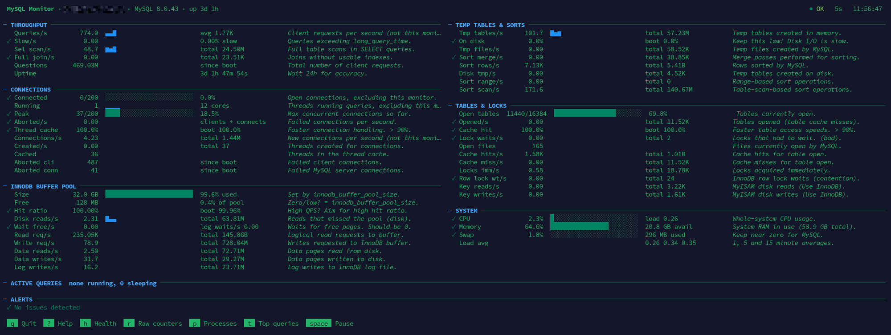
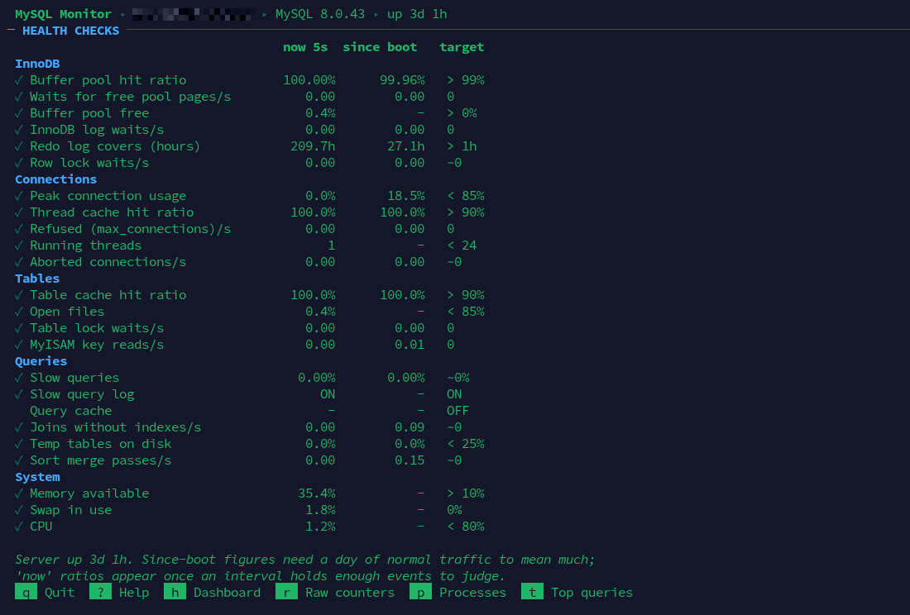
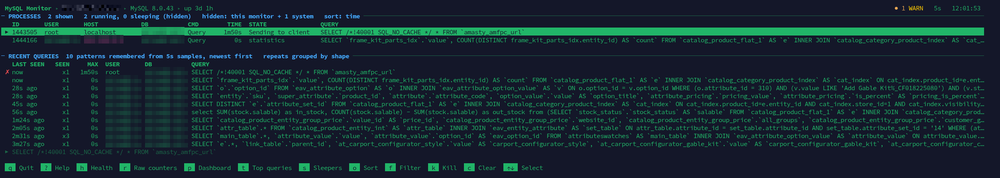
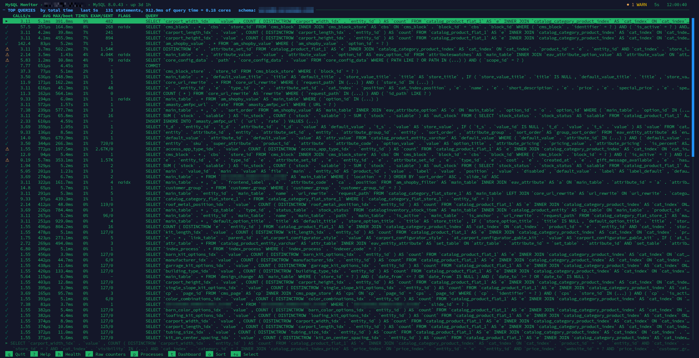
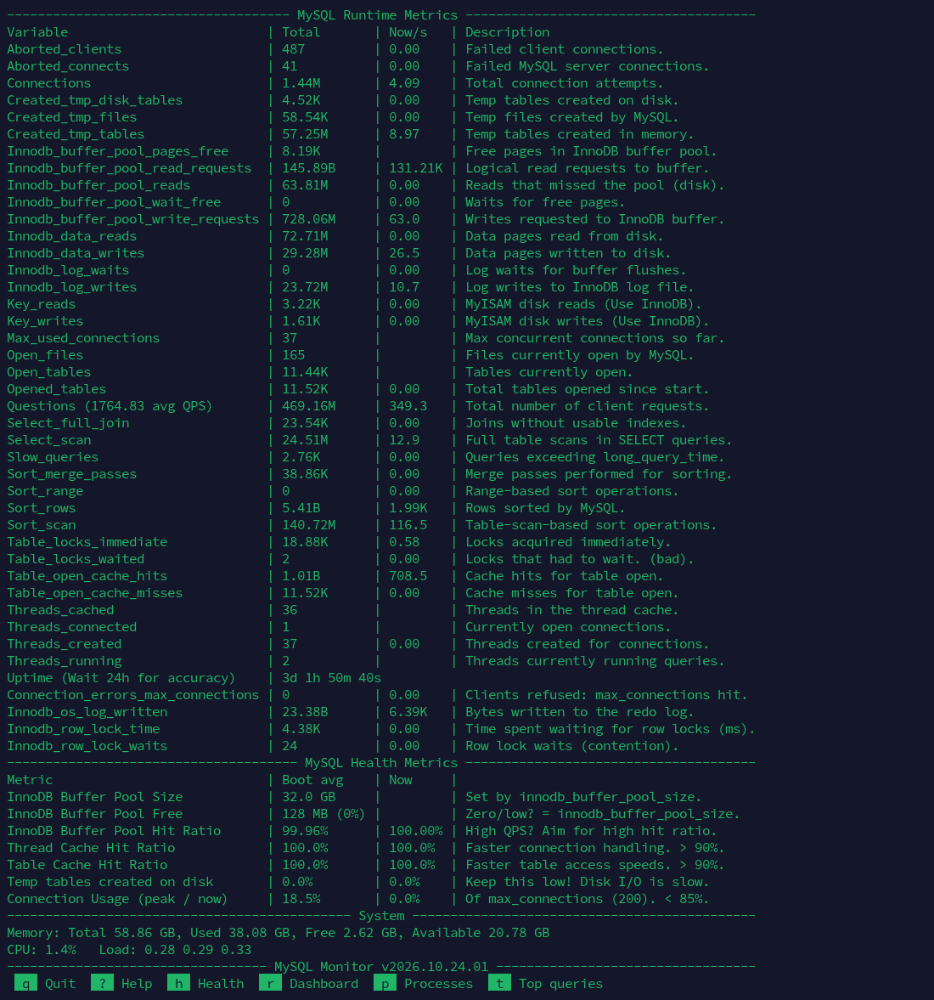
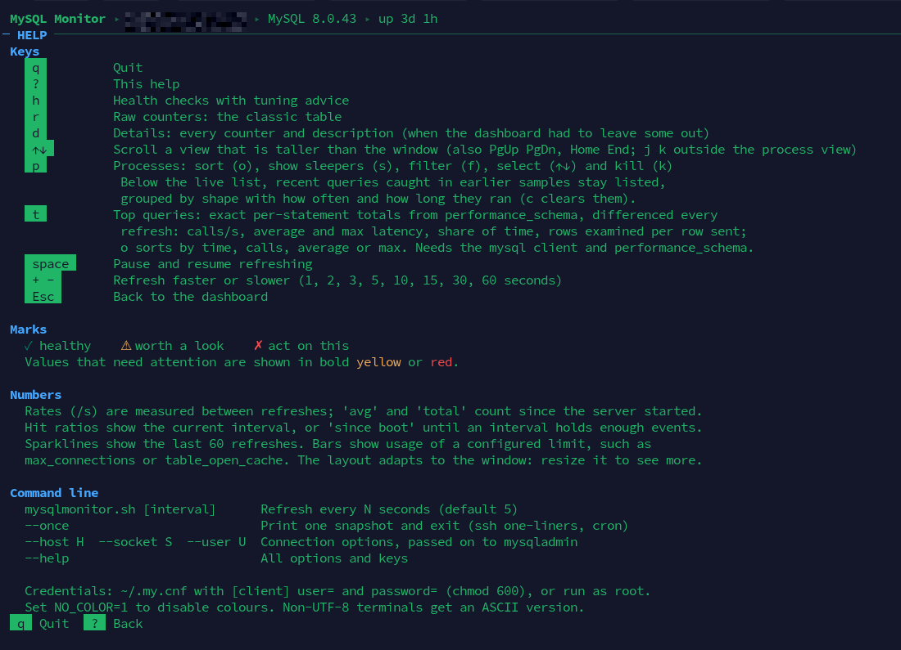

## MySQL Monitor Script


A lightweight bash script that gives sysadmins and DBAs a live view of a MySQL or MariaDB server from the terminal: throughput, connections, InnoDB buffer pool, temp tables, table cache and system load with per-second rates, sparklines and plain-English alerts, plus health checks with tuning advice, the process list, and the server's top queries. One file, no dependencies beyond `bash`, `awk` and the MySQL client tools.

## How to Install and Use
Cut and paste each step.

### Step 1: Download the script
```bash
curl -O https://raw.githubusercontent.com/haydenjames/mysqlmonitor-script/main/mysqlmonitor.sh
```

### Step 2: Make the script executable
```bash
chmod +x mysqlmonitor.sh
```

### Step 3: Run the script
```bash
./mysqlmonitor.sh
```

Done! 

---------------------------------------------------

or...
### Single command install and run
Simply cut and paste. This command will download and run mysqlmonitor.sh immediately.  
```bash
curl -O https://raw.githubusercontent.com/haydenjames/mysqlmonitor-script/main/mysqlmonitor.sh && \
chmod +x mysqlmonitor.sh && \
./mysqlmonitor.sh
```

## Complementary Guide 
Linuxblog.io: [MySQL Monitor: A Simple MySQL Monitoring Script](https://linuxblog.io/mysql-monitor-script/) - This blog post provides detailed guidance on the variables used in the script, along with links to common MySQL tuning pitfalls and tips to help you optimize your database performance.

## What you see
A dashboard grouped into panels: throughput, connections, InnoDB buffer pool, temp tables & sorts, tables & locks, and system. Rates are per second since the last refresh, with sparklines of recent history, bars against configured limits (`max_connections`, `table_open_cache`) and ✓ / ⚠ / ✗ marks. An alerts box explains what needs attention and which setting to look at.

The layout adapts to the terminal and shows as much as fits: up to three columns, detail lines with every counter's rate and total since boot when there are enough rows, a description of each metric when there is enough width, and a compact summary that fits 80×24. Panels are packed into columns by height, and any rows left over show the active queries, longest-running first (idle connections and background threads are hidden).

### Screens

**`h` Health checks**: every ratio and rate against its target, with the setting to change and a suggested value when one fails.



**`p` Processes**: what is running now, with sort, filter and kill, and the recent queries caught in earlier samples.



**`t` Top queries**: exact per-statement totals from `performance_schema`, differenced every refresh. This sees every query, including the millisecond ones the process list can never catch.



**`r` Raw counters**: the classic table, and **`?` Help**.





| Key | Action |
| --- | --- |
| `q` | Quit |
| `?` | Help: keys, marks and what the numbers mean |
| `h` | Health checks: each ratio and rate against its target, with the setting to change and a suggested value when one fails |
| `p` | Processes: running queries, longest first. `o` cycles the sort (time, id, user, db), `s` shows sleeping connections, `f` filters as you type, `↑` `↓` select a row and `k` kills it after a confirmation. Below the live list, **recent queries** caught in earlier samples stay listed, newest first, grouped by shape (literals replaced) with how often and how long they ran, so repeats and slow ones stand out even when each connection is short-lived; `c` clears the history |
| `t` | Top queries: exact per-statement totals from `performance_schema`, differenced every refresh. Calls/s, average and max latency, share of query time, rows examined per row sent, and tmp/sort/no-index flags; `o` sorts by time, calls, average or max; `↑` `↓` show a statement's full text. Unlike the sampled process list, this sees every query, including the millisecond ones. Needs the `mysql` client; `performance_schema` is on by default in MySQL 5.7/8.0 and needs `performance_schema = ON` on MariaDB |
| `r` | Toggle the raw counters table (the classic view) |
| `space` | Pause and resume refreshing (the header shows PAUSED) |
| `+` `-` | Refresh faster or slower: 1, 2, 3, 5, 10, 15, 30 or 60 seconds |
| `d` | Details: every counter and its description, in as many columns as fit the width. Offered when the fitted dashboard had to leave something out; `d` or `Esc` returns |
| `↓` `↑` / `j` `k`, `PgDn` `PgUp`, `Home` `End` | Scroll, whenever a view is taller than the window. The header and alerts stay in place |

`./mysqlmonitor.sh --help` lists the options and keys; `-i N` or a bare number sets the refresh interval.

- `--once` prints one snapshot and exits: handy over ssh (`ssh db1 ./mysqlmonitor.sh --once`), in cron, or to paste into a ticket. Output to a pipe or file is plain text.
- `--host`, `--port`, `--socket`, `--user`, `--defaults-file` and `--login-path` are passed to `mysqladmin`; anything after `--` is passed verbatim. Passwords are never taken on the command line: use `~/.my.cnf`.
- `--no-color` / `--color` and `--ascii` override the automatic choices (colour only on a terminal, Unicode only in a UTF-8 locale). `NO_COLOR=1` also disables colour. Non-UTF-8 terminals get an ASCII version automatically.

## Testing
`tests/run.sh` checks every view at 20 terminal sizes with gawk, mawk and busybox awk, simulates key presses with SSH-like timing, and tries `--once`, all against a fake `mysqladmin` in `tests/bin`, so no MySQL server is needed. Run it after any change to the script.

## Requirements
`bash` 4.2+, `mysqladmin` (or `mariadb-admin`) and any POSIX `awk` (gawk, mawk or busybox awk). CPU, load and memory are read from `/proc`.

When the `mysql` (or `mariadb`) client is installed, the process list is read through it (`SHOW FULL PROCESSLIST`), which gives the full text of each query; without it, `mysqladmin processlist` is used and queries are cut at 100 characters. The top queries view needs the client and SELECT on `performance_schema`. To see other users' queries, the MySQL user needs the `PROCESS` privilege (root has it); without it only that user's own queries are listed. Killing another user's query needs `SUPER` (or `CONNECTION_ADMIN`).

## Terminal size
The screen is redrawn in place, so it no longer scrolls or flickers. If the window is too small to fit everything, the script tells you the size it needs and redraws as soon as you resize.

## Common Troubleshooting
Here are some common issues and how to resolve them:

### 1. Missing MySQL Credentials
If the script fails to connect to your MySQL server due to missing credentials, you may need to create a `~/.my.cnf` file for automatic authentication.

#### Steps to Create `.my.cnf`:
1. Create the file:
    ```bash
    nano ~/.my.cnf
    ```

2. Add the following structure to the file:
    ```makefile
    [client]
    user=your_mysql_username
    password=your_mysql_password
    ```

3. Secure the file permissions:
    ```bash
    chmod 600 ~/.my.cnf
    ```

4. Rerun the script.

---

### 2. Running the Script with `sudo`
If you encounter permission issues as a non-root user, try running the script with `sudo`:
```bash
sudo ./mysqlmonitor.sh
```

---

### 3. Verifying MySQL Status
If the script fails to connect even with credentials:
- Ensure the MySQL server is running:
    ```bash
    sudo systemctl status mysql
    ```
    or
    ```bash
    sudo systemctl status mariadb
    ```
- Verify that the credentials in `~/.my.cnf` are correct.

---------------------------------------------------
Thank you for using MySQL Monitor, we hope it helps simplify your database monitoring and tuning tasks!
